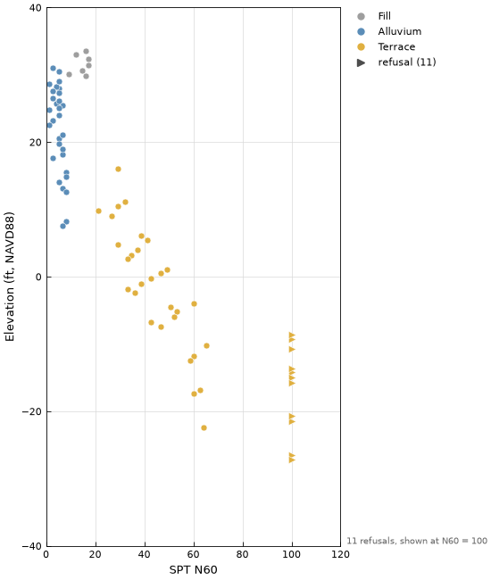

*Hangtu* is Chinese for rammed earth, one of the oldest ways of building with soil: it raised city walls in China more than 4,500 years ago. `hangtu` respects the long tradition of humans building with earth materials while automating the mundane and leaving judgment to the engineer.

**Documentation:** [konnerhorton.github.io/hangtu](https://konnerhorton.github.io/hangtu/)

Plots, data checks, analyses and statistics for geotechnical engineers, in US or SI units. hangtu reads **AGS4** data files into a project database, checks them, and turns them into ready-made tables of test results (SPT, index tests, density, triaxial, undrained strength, shear box) that go straight into its plots and analyses. Everything also works on your own CSV files.

> **Status:** early release. Names and arguments may still change before 1.0.

## Install

```bash
pip install hangtu      # or: uv add hangtu
```

For the latest features, which the documentation follows, install from GitHub:

```bash
pip install git+https://github.com/konnerhorton/hangtu
```

hangtu needs Python 3.12 or later and runs on Windows, macOS and Linux.

## From an AGS file

```python
import hangtu as ht

# Read the file into a project database (here an example site that ships with hangtu).
p = ht.Project.from_ags(
    ht.examples.path("site.ags"), db="site.sqlite", display_units="US", vertical_datum="NAVD88"
)
p.set_geology_map(ht.examples.path("strata.csv"))  # geology codes -> units, order, colors

report = p.qc()  # check the data
print(report)
report.to_csv("qc_report.csv")  # every finding, with its hole, depth and line in the file

fig, ax = ht.plot.spt_profile(p.spt(), n="spt_n60")
fig.savefig("spt_profile.png")
fig, ax = ht.plot.grain_size(p.grain_size())  # grading curves with the USCS fractions
fig, ax = ht.plot.water_content_profile(p.atterberg())  # w with a PL to LL bar per specimen
```



`p.spt()`, `p.atterberg()`, `p.grain_size()`, `p.triaxial()`, `p.undrained_strength()` and the other datasets give one row per test, with its depth, elevation and geology unit joined on. They take filters such as `holes=`, `geology=` and `depth=`.

## From your own CSV files

Save an empty template, fill it in (in Excel or anything else that saves CSV), then read it back with its units:

```python
ht.template("spt").to_csv("my_spt.csv", index=False)  # an empty file to fill in

spt = ht.read_csv(
    ht.examples.path("spt.csv"),  # or your own file
    units={"ground_level": "ft", "depth": "ft", "elevation": "ft", "spt_penetration": "in"},
)
fig, ax = ht.plot.spt_histogram(spt[spt["soil_class"] == "coarse"], n="spt_n60")
```

`ht.columns("spt")` lists each template column with its description and unit. Both examples in full, with all four plots on one sheet, are in [`examples/`](https://github.com/konnerhorton/hangtu/tree/main/examples).

## What it does

- **AGS4 ingest** (versions 4.0.3 to 4.2) into a SQLite project database, with units read from the file and converted on the way in. Values such as `NP`, `<0.1` and refusals are kept as flags, never as blanks.
- **Data checks** (`p.qc()`): about 60 rules on locations, geology, depths, SPT, Atterberg limits, grading, permeability, density, triaxial, undrained strength and shear box results, plus required fields. Results come as a summary and a CSV report, and `p.diff()` compares two versions of a file.
- **Datasets** for SPT, Atterberg limits, grain size curves, permeability, density, particle density, triaxial stages, undrained strength (UU, unconfined compression, vanes, hand penetrometer, fall cone) and shear box stages. Each test gets its depth (SPT at mid-drive), elevation and geology unit, and a geology map gives the units their order and colors.
- **Plots:** property profile (any property against depth or elevation, linear or log), SPT profile, water content profile, SPT class histograms, property by geology unit against a report's baseline, plasticity chart (USCS or BS 5930), grain size curves with the soil fractions, clogging diagram, distribution fit, Mohr–Coulomb failure envelope, and triaxial stress–strain curves and stress paths. Each is an ordinary matplotlib figure.
- **Analyses** as plain functions on a DataFrame (`ht.analysis`): SPT N60, (N1)60 and classes; vertical stress; phase relations and clay activity; USCS, AASHTO and gradation; triaxial stresses at failure and the Mohr–Coulomb fit; s_u from the undrained tests; and published SPT correlations for friction angle, s_u, stress history and stiffness, each with its source and range.
- **Statistics** (`ht.stats`): summaries, distribution fits that keep "less than" and "more than" values, group comparisons and cross-tabulations.
- **Judgments have no defaults:** an input that is the engineer's call, such as a hammer's energy ratio or an assumed specific gravity, comes from an argument or the project's judgments file, or hangtu stops and names it.
- **Units that follow the data:** each column's units are declared once, and every plot converts to US or SI. hangtu never guesses a unit.
- **Nothing is dropped silently:** values beyond the axis limits, blanks and "less than" values are drawn or counted on the figure.
- **Printable sheets** (`ht.Sheet`): several plots on one tabloid or letter page, saved as PDF, PNG or SVG.

## Roadmap

hangtu is heading toward **the ground parameters a design needs**, for soil and rock: from the test data, through direct derivations and published correlations, to selected values and constitutive-model parameter sets (Mohr–Coulomb, Hardening Soil, generalized Hoek–Brown, Soft Soil). The docs explain each parameter as it is built: what it is, why it matters, and how it is determined.

The work comes in waves, each built around a shared piece of engineering:

| | What it covers |
|---|---|
| Built | Plots, AGS4 ingest and checks, the datasets and classification; vertical stress, phase relations and SPT correlations with (N1)60; the clogging diagram; statistics; triaxial, undrained strength and shear box data with the Mohr–Coulomb, shear box and intact Hoek–Brown fits; and selection: comparing sources, Eurocode 7 characteristic values, design lines and the Mohr–Coulomb parameter set |
| Planned | Test curves (triaxial, swelling, shear box) carried in the AGS file; oedometer and swelling, with the Soft Soil set; rock mass (Hoek–Brown, modulus, in situ stress), with the generalized Hoek–Brown set; soil stiffness, with the Hardening Soil sets; field permeability |

Releases follow when a piece is ready to use; they aren't tied to the waves. What each release holds, and what is on `main` but not yet released, is in the [changelog](https://github.com/konnerhorton/hangtu/blob/main/CHANGELOG.md).

The full specification is in [SPEC.md](https://github.com/konnerhorton/hangtu/blob/main/SPEC.md), and each plot has its own spec in [docs/plots](https://github.com/konnerhorton/hangtu/tree/main/docs/plots).

## Who it's for

Geotechnical engineers comfortable writing short Python scripts. The library assumes scripting skills picked up in engineering or science work, not a software-development background.

## License

MIT
