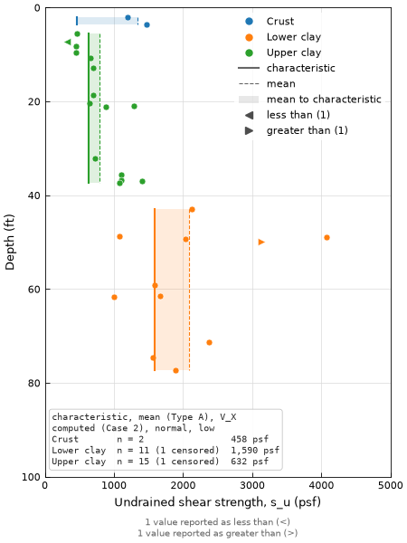
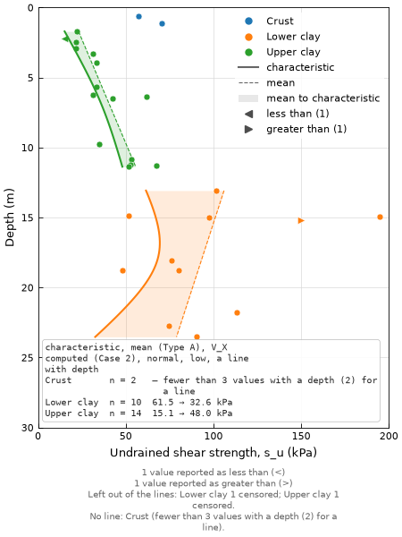

# P09 — Representative value profile

| | |
|---|---|
| **ID / function** | P09 · `ht.plot.representative_profile()` (+ `ht.stats.representative()`; also `RepresentativeResult.plot()`) |
| **Status** | built (M18 (c), 2026-11-04) |
| **Type** | plot + analysis (statistics) |
| **Milestone** | M18 (c) (`STATUS.md`), [`docs/work/m18c-representative-profile.md`](../work/m18c-representative-profile.md) |
| **Depends on** | P01; `ht.stats.representative()` (M18 (b), [`m18b-representative-values.md`](../work/m18b-representative-values.md) Spec) |
| **Related** | P08 (the precedent: a plot that runs a statistic and draws its result); SPEC §4, §5; [`statistics.md`](../analysis/statistics.md) §2 |

Formerly "characteristic value profile", `characteristic_profile`: renamed with `representative()`, the function it draws.

| Constant per unit (US) | Line with depth (SI) |
|---|---|
|  |  |

---

## 1. Purpose
Shows one parameter's values against depth or elevation with the representative value `representative()`
computed for each geology unit, constant or as a line with depth, beside the mean (or median) it came from. A
reviewer sees in one figure what was selected, from which values, and how cautious it is, and judges by eye
whether a trend is believable, a constant too low at depth, or one unit really two. The figure says which view
it is and which judgments made it, so it can go in a design report or calculation package without a table
beside it.

## 2. Reference figure
```
             Undrained shear strength, s_u (kPa)
           0        50       100      150
         0 ┼────────┼────────┼────────┼──
           │  ● ●┆▒│                         ● Alluvium   ━ characteristic
           │ ●  ●┆▒│●                        ● Clay       ┄ mean
         5 ┤    ● ┆▒▒│  ●                                ▒ mean to characteristic
Depth      │       ┆▒▒│●   ●
(m)     10 ┤        ┆▒▒▒│    ●  ●
           │          ┆▒▒▒│ ●     ▷
        15 ┤ ┌──────────────────────────────┐
           │ │ characteristic, mean (Type A),│
           │ │ V_X computed (Case 2), normal,│
           │ │ low, a line with depth        │
           │ │ Alluvium  n = 8   —  fewer…   │
           │ │ Clay      n = 14  32 → 71     │
           │ └──────────────────────────────┘
  Left out of the lines: Clay 1 censored. No line: Alluvium (fewer than 3 values with a depth (2) for a line).
```
A good version: the representative line sits clearly on the cautious side of the mean, the band between them
shows the size of the reduction at every depth, the line spans only the depths of its unit's values, and every
value the lines didn't use is still on the figure or counted under it.

## 3. Input data
**Row grain:** one row per value, as `representative()` reads (P01's rows).

| Column | Description | Req.? | Notes |
|---|---|---|---|
| `value=` | the parameter, any registry column | ✔ | units as SPEC §2.6 |
| `depth` or `elevation` | where each value is | ✔ | the trend's column for a trend; for a constant, the one `result.vertical` names |
| `by=` column | the groups, one column or none | | also P01's `color_by`, so a line and its values share a color |
| flag and source columns | `spt_refusal`, `qualifier`, `non_plastic`, assumed flags, `source`, … | | read by `representative()` and P01 |

**Value flags handled:** P01 draws every row as it always does (refusals and text at the edge, `<x`/`>x` as
carets, bands as bars, assumed values as values). P09 adds only what the lines did with them, in the footnote
(§8):
- **A constant** takes censored values through the censored fit (M18 (b) decision 2): they are in the line and
  in the table's n, with "(k censored)".
- **A trend** leaves censored values and values with no depth out (M18 (b) decision 8): counted per unit as
  "Left out of the lines".
- **Left out by both** (non-plastic, assumed unless `include_assumed=True`, bands, text): drawn by P01 and counted
  in P01's own footnote lines as now; P09 adds "Not in the lines: 2 assumed, 1 range" from the result's counts, for
  the kinds P01 draws as values (assumed, bands) and so doesn't already say are left out.

**Minimum data:** as `representative()`: a unit with fewer than 2 values (constant) or 3 values at 2 depths
(trend) gets no line; its values are drawn and the table and footnote give the reason.

## 4. Analysis / calculations
`ht.stats.representative()` (M18 (b) Spec, decisions 1–11). The plot computes nothing of its own (SPEC §5, "one
calculation, many views"):
- **Lines:** the coordinates of each unit's representative line and mean (median, for a lognormal view) line
  are exactly `result.design_lines(mean=True)`: two points for a constant, 50 along a trend, over the unit's
  depths only.
- **Band:** filled between those two lines at the same depths.
- **Table and footnote:** read from `result.groups` (value or `value_top`/`value_base`, counts, reason) and
  `result._view()`.

Nothing new is needed on `RepresentativeResult` for this: the lines, the view's name and every count are
already kept. If the build finds a gap, it is added to the result with a test (intent, "Out of scope").

## 5. Figure layout
- **Panels:** one, P01's.
- **Default size:** the `profile` kind (4.5 × 6.0 in), as P01.
- **Orientation:** portrait.

## 6. Axes
P01's, unchanged (labels, inverted depth, log on the preset or `log=`, limits, out-of-range markers). Two rules
on the vertical axis:
- **A trend** is drawn against its own column: `vs` defaults to `result.trend`, and the other is an error (the
  line is in depth, or in elevation, only).
- **A constant** defaults to `result.vertical` (`depth` when the data has it). The other `vs` follows P01's rule
  for converting design lines: one ground level for all rows, else P01's error.

## 7. Data marks
| Series | Mark | Color | Legend |
|---|---|---|---|
| Values | P01's | by unit | P01's unit entries |
| Representative line | solid, 1.5 pt | the unit's color | one gray style entry naming the view briefly: "characteristic", "percentile 10", "mean − 1.5 std" |
| Mean (median) line | dashed, 0.8 pt | the unit's color | gray entry "mean" or "median" |
| Band | fill between the two, alpha 0.15 | the unit's color | gray entry "mean to characteristic" (or "… to percentile 10") |

**Draw order:** P01's strata and ranges → band → P01's values → mean line → representative line → table and
footnote. The band goes under the values so no value is hidden.

P01's own design-line style (gray, labeled at the deepest point) isn't used: with several units, color is what
pairs a line with its values, and the table names the view.

## 8. Overlays and annotations
| Overlay | Argument | Default | Style |
|---|---|---|---|
| Mean (median) line | `mean=` | on | §7 |
| Band | `band=` | on | §7; independent of `mean=` |
| Table | `table=` | on | Text box at P01's stats-box place (lower left, with its room rule): the view in full, `result._view()`, wrapped, then one row per unit in legend order: unit, n (with "k censored" for a constant), the value (constant) or "top → base" (trend), 3 significant figures in the display unit; a unit with no line shows "—" and its reason, wrapped at 40 characters under its own text so the table stays narrow. Replaces P01's `stats_box`, which isn't offered (the two would overlap and say different things) |
| Footnote | — | when non-zero | below P01's lines: "Left out of the lines: Clay 2 censored, 1 with no depth"; "Not in the lines: 2 assumed"; "No line: Fill (fewer than 2 values (1))". Each wrapped at 64 characters, so a line listing several units fits under the axes |
| P01's overlays | `strata=`, `water_level=`, `ranges=`, `reference_lines=`, `note=` | off | passed to P01 |

**Values drawn or not** (intent "Out of scope"): `values=False` draws only the lines, band and table, into
a given `ax=` (an error without one). That is how a second view goes on the same figure: the values once, the
views by call. Comparing sources is `compare_sources()` (`statistics.md` §5). The rules:
- `ax=` must hold a profile drawn by P09 or `profile()` (it keeps `ax.ags_profile`), of the same parameter;
  the view is drawn in its coordinates and limits. P01's drawing arguments (`preset=`, `xlim=`, `strata=`,
  `legend=`, …) are an error with `values=False`: they belong to the call that drew the values.
- A second view's representative line is dash-dot, a third's dotted, so the legend tells them apart; the mean
  and band keep their style. Its legend entries join the legend, an entry already there ("mean") once.
- Its table rows join the table already there, after a blank line, rather than a second box over it.
- Its footnote lines join the footnote, a line already there once; the legend and footnote are redrawn once,
  not drawn twice. A line beyond the profile's limits is clipped and counted, as with `xlim=`.

## 9. Units behavior
- `display_units=` goes to both `representative()` and P01, so the values, the lines and the table are in the
  same units; US and SI differ only by the conversion.
- `RepresentativeResult.plot()` draws in the units the result was computed in (`result.display_units`); a
  different `display_units=` is an error naming both, rather than converting the table. A result computed
  without `display_units=` is drawn in `ht.settings.display_units`, its lines and table converted with the
  values, as P01 has no "the data's units".
- N and dimensionless values have no unit.

## 10. API
```python
def representative_profile(
    df: pd.DataFrame,
    *,
    value: str,
    by: str | None = None,
    # representative()'s judgments, passed through; none has a default (SPEC §4)
    method: str | None = None,
    side: str | None = None,
    distribution: str | None = None,
    trend: str | None = None,
    estimate: str | None = None,
    coefficient_of_variation: float | None = None,
    scale_of_fluctuation: float | None = None,
    failure_length: float | None = None,
    sensitivity_index: float | None = None,
    percentile: float | None = None,
    standard_deviations: float | None = None,
    pool: str | list[str] | None = None,
    include_assumed: bool = False,
    spt_refusal_upper_limit: float | str | Mapping[str, float | str] | None = None,
    judgments: Any = None,
    # what P09 adds
    mean: bool = True,
    band: bool = True,
    table: bool = True,
    values: bool = True,
    # P01's, passed through
    vs: Literal["elevation", "depth"] | None = None,
    preset: str | None = None,
    log: bool | None = None,
    label: str | None = None,
    marker_by: str | None = None,
    connect: bool = False,
    intervals: bool | Literal["auto"] = "auto",
    xlim: tuple[float, float] | None = None,
    ylim: tuple[float, float] | None = None,
    xaxis_position: Literal["top", "bottom"] = "bottom",
    secondary: Literal["depth"] | None = None,
    strata: pd.DataFrame | None = None,
    water_level: float | list[tuple[float, str]] | pd.DataFrame | None = None,
    ranges: pd.DataFrame | str | None = None,
    reference_lines: list[tuple[float, str]] | None = None,
    note: str | None = None,
    palette: dict[str, str] | None = None,
    units: dict[str, str] | None = None,
    display_units: Literal["US", "SI"] | None = None,
    legend: Literal["auto", "inside", "bottom", "right"] | bool = "auto",
    figsize: tuple[float, float] | None = None,
    ax: Axes | None = None,
    **style_overrides: Any,
) -> tuple[Figure, Axes, RepresentativeResult]:
```
- Calls `representative()` with its arguments, then draws P01 with `color_by=by` and the result's lines.
  Every judgment error is `representative()`'s, unchanged.
- **`by=`** is one column or None: a line's color is its unit's, so a group must be one P01 color. Several
  columns are an error that says to filter the rows or make one column. None is one group, "All", in P01's
  single color.
- **Not offered:** `color_by` (it is `by`), `design_lines` (P09 draws its own), `stats_box` (the table takes its
  place).
- **`RepresentativeResult.plot(df, **kwargs)`** draws the same figure from an existing result, with the drawing
  arguments above. The result keeps statistics, not rows, and P01 draws every row, so it takes the data
  again and checks that they are the rows the result was computed from: the same groups with the same counts
  (`count` and each `count_*`), else an error saying which group differs. Returns `(fig, ax)`. The check reruns
  `representative()` with the view the result records; `count_interval_censored` isn't compared, because the
  refusal limit isn't given again (the refusals are still in `count_at_least`), and `units=` is passed again
  when the result's call took it.
- **Sources mixed in a group:** `representative()` raises (sources aren't pooled unawares, SPEC §5), and that
  governs, as in P08. P01's "mixes sources" is a stats-box line, not used here.

**Example:**
```python
fig, ax, result = ht.plot.representative_profile(
    strength, value="undrained_shear_strength", by="geology_unit",
    method="characteristic", estimate="mean", side="low", distribution="normal",
    trend="depth")
```

## 11. Edge cases and data quality
| Situation | Behavior |
|---|---|
| No unit gets a line | Values drawn; table rows "—" with reasons; no line entries in the legend; no error |
| No `depth` or `elevation` column | `representative()`'s error for a trend; for a constant, the error `design_lines()` raises |
| Constant at or below 0 on a log axis | The line is drawn as P01 draws a value ≤ 0: not drawn, counted in the footnote |
| Trend crosses 0 (normal) | `representative()` warns; on a linear axis drawn as is, on a log axis the part ≤ 0 is cut and counted |
| Representative beyond `xlim=` | The line is clipped at the axis; the footnote counts the units "line beyond axis limit" |
| `vs` not the trend's column | Error naming both |
| `values=False` without `ax=` | Error |
| `result.plot(df)` with other rows | Error naming the group whose counts differ |
| Mixed sources, missing units | `representative()`'s errors |

## 12. Acceptance criteria and tests
1. **Lines from the result:** each unit's representative and mean line are `result.design_lines(mean=True)`'s
   points for that unit (1e-12, in display units), for a constant and a trend, normal and lognormal (median).
2. **Band:** one filled polygon per unit with a line, bounded by those two lines; none with `band=False`.
3. **Table:** the view string is `result._view()`; each unit's row has its n, value (constant) or top → base
   (trend) to 3 significant figures, and a unit with no line has "—" and `result`'s reason; none with
   `table=False`.
4. **Trend, censored:** with two refusals in one unit and one value with no depth, P01 draws all three as it
   would, and the footnote reads "Left out of the lines: <unit> 2 censored, 1 with no depth", agreeing with
   the result's counts.
5. **Left out by both:** two assumed values are drawn by P01 and counted as "Not in the lines: 2 assumed";
   with `include_assumed=True` the lines are `representative(..., include_assumed=True)`'s and that footnote
   line goes away.
6. **Judgments:** a call missing `side` raises `representative()`'s error, unchanged; nothing is defaulted.
7. **Arguments:** `mean=False`, `band=False`, `table=False` each remove only their part; `values=False` with
   `ax=` adds only lines, band and table to an existing P01 axes; `by=["a", "b"]` and a `vs` other than the
   trend's raise.
8. **Same figure from the result:** `result.plot(df, ...)` and `representative_profile(df, ...)` give the same
   artists' data; `result.plot()` with a row removed raises naming its group.
9. **Contract:** `ax=` draws into the axes and makes no figure; matplotlib's `rcParams` are unchanged after a
   call; returns `(fig, ax, result)`.
10. **Units:** US and SI calls differ only in labels and values scaled by the conversion; `result.plot()` with a
    `display_units=` other than the result's raises.
11. **Visual check:** lab data, a seeded synthetic undrained shear strength set made in the image script
    (two or three clay units, one rising with depth, a few `<x`/`>x` values). s_u has no assumed flag in the
    registry, so the assumed case is tested (criterion 5, on particle density) but not drawn here. The scatter
    is what a site gives, not a clean line: a coefficient of variation of about 0.3 around each unit's mean or
    trend, a skew to the high side, uneven depths with gaps and clusters, and one or two outliers, so the
    lines don't sit neatly through the points. That is also what shows the band between mean and representative
    at a useful width. The data are made this way because the
    example project's s_u is too thin (10 values in one unit, from four test types, which `representative()`
    won't pool unasked). `docs/plots/img/P09-us.png`, a constant view per unit; `docs/plots/img/P09-si.png`, a
    depth trend. 100 dpi, looked at and committed in the close-out.

## 13. References
As the M18 (b) Spec (Orr et al. 2025, JRC EUR 40260, quoting EN 1997-1:2024; Bond & Harris 2008 as given
there). The plot adds no method.

## 14. Open questions
- None. The figure's data are made in the site example (`docs/site/examples/representative-profile.py`), so the
  images can be redrawn from it.

## 15. Future enhancements
- Several views compared as a feature, and sources compared by depth (M18 (d)).
- The full confidence or prediction interval around a trend, both sides (the curves are in the result).
- Residuals of a trend against depth, to check its assumptions (the result keeps them).
