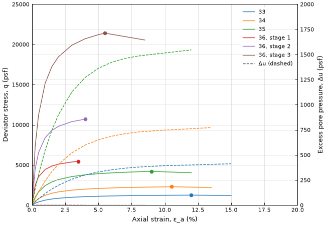
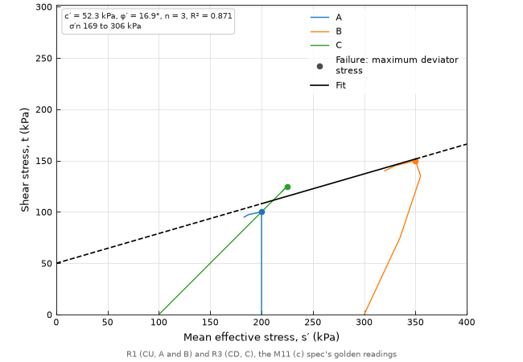

# P12 — Triaxial shearing: stress–strain curves and measured stress paths

| | |
|---|---|
| **ID / function** | P12 · `ht.plot.triaxial_shearing()` (+ `ht.analysis.triaxial_failure_from_readings()`) |
| **Status** | built |
| **Type** | plot + light analysis |
| **Milestone** | M11 (c) (`STATUS.md`), [`docs/work/m11c-triaxial-shearing.md`](../work/m11c-triaxial-shearing.md) |
| **Depends on** | P00; `triaxial_failure_stresses()` (M11 a); `mohr_coulomb_fit()` and P11 (M11 b) |
| **Related** | P11 (the same failure points and fit); sheet 04; TODO #53 |

---

## 1. Purpose
Shows how each triaxial stage behaved during shearing, from its readings at each strain step, so the failure
points P11 fits can be checked. One function, three views chosen with `space=`:
- `"stress_strain"`: deviator stress against axial strain, with excess pore pressure (undrained) or volumetric
  strain (drained) on an optional second y axis.
- `"s_t"` or `"p_q"`: the measured stress path, with the failure envelope P11 fits to the same stages.

Answers: did the specimens contract or dilate, how did pore pressure develop, where did each stage fail and by
which criterion, and does one envelope fit them. P10 (stress–strain curves) was merged in, because it draws the
same readings.

**Where the readings come from.** AGS carries only the values at failure (`TRET` and `TRIT` have one row per
stage; checked against the 4.1–4.2 dictionaries, 2026-10-15). Readings arrive as exports from the lab's software,
which the user shapes into a CSV in `ht.template("triaxial_readings")`'s shape (decided 2026-10-15). There is no
reader for lab software formats.

## 2. Reference figure
`space="s_t"`:
```
   t (kPa)
  150 ┤                       ___●  ← failure reading
      │                 ___-‾‾ ╱
  100 ┤       ●____-‾‾‾       ╱  ← fitted line (P11's fit of the failure readings)
      │  ___-‾╱ ╲            ╱
      │  ‾   ╱   ← measured path (CU: σ′ falls as Δu rises)
    0 ┼─────●──────────────●───────
      0    100   200     300   s′ (kPa)
```

`space="stress_strain", second_axis="excess_pore_pressure"`:
```
   q (kPa)                                   Δu (kPa)
  300 ┤        ___●‾‾‾‾‾‾‾‾‾‾‾‾  ← q, failure marked     ┤ 150
      │     _-‾                                         │
  150 ┤   ╱      - - - - - - - -  ← Δu (dashed)          ┤ 75
      │  ╱  - -‾                                        │
    0 ┼─●──────────────────────────────                 ┤ 0
      0     5     10     15    axial strain (%)
```
**A good version:** one color per stage, the same in every view; the failure reading marked with the same dot in
every view and on the fit; equal aspect in s′–t and p′–q, so the paths' slopes read true.

## 3. Input data
**Row grain:** one row per reading. The stage's values repeat on each of its rows, so the file is one sheet.
`ht.template("triaxial_readings")` has these columns, ordered as `ht.template("triaxial")` orders its own, with
the reading columns after the stage's and `geology_unit` last:

| Column | Per | Quantity kind | Req.? | Notes |
|---|---|---|---|---|
| `loca_id`, `sample_reference`, `specimen_reference`, `depth` | stage | –, –, –, length | – | carried to the failure rows; labels |
| `specimen_id` | stage | text | ✔ | with `test_stage`, says which stage a reading belongs to |
| `test_stage` | stage | text | – | blank or missing: one stage per specimen |
| `test_type` | stage | text | ✔ | the AGS `TREG_TYPE`/`TRIG_TYPE` code, as `ht.template("triaxial")` |
| `failure_criterion` | stage | text | – | the lab's, as written; replaced on the failure rows when hangtu picks (§4) |
| `effective_consolidation_stress` | stage | stress | – | carried; the path starts at `cell_pressure` − `back_pressure` (§4) |
| `back_pressure` | stage | stress | ✔ effective | |
| `cell_pressure` | stage | stress | ✔ | constant during the stage |
| `axial_strain` | reading | percent | ✔ | from the start of shearing; within a stage, never decreasing |
| `deviator_stress` | reading | stress | ✔ | q = σ1 − σ3, as the lab corrected it (area, membrane). hangtu doesn't redo the corrections |
| `excess_pore_pressure` | reading | stress | ✔ undrained, effective | Δu from the start of shearing, positive for a rise |
| `volumetric_strain` | reading | percent | – | from the start of shearing, positive in compression (dilation negative) |
| `reported_failure_reading` | reading | bool | – | True on the lab's failure reading; at most one per stage |
| `geology_unit` | stage | text | – | color, and a common `group_by=` |

Any other column the user adds is a stage column: carried to the failure rows, and checked to be the same on all
of a stage's readings.

**Grouping columns used:** `group_by=` (one fit and one color per group); `color_by=` (paths and curves only).

**Value flags handled:** none. A reading with a blank `axial_strain` or `deviator_stress` is left out of the curve
and counted; a blank `excess_pore_pressure` leaves that reading out of the undrained effective path, counted.

**Minimum data:** 1 reading to draw; 2 failure readings per group to fit (1 with `cohesion=0`), as P11.

## 4. Analysis / calculations
**Per reading** (definitions, as `triaxial_failure_stresses()` uses at failure; derived in the M11 (b) Spec):
- σ3 = `cell_pressure`, σ1 = σ3 + q.
- u = `back_pressure` + Δu; σ′3 = σ3 − u, σ′1 = σ′3 + q. In a drained stage (`CD`, `CDM`, `CIDC`, `CADC`)
  with Δu blank, u = `back_pressure` (Δu = 0, the drained condition), as `triaxial_failure_stresses()` reads a
  drained stage at failure. In any other stage with Δu blank, the effective stresses are blank.
- s = (σ1 + σ3)/2, t = (σ1 − σ3)/2 = q/2; p = (σ1 + 2σ3)/3, q (triaxial compression), primed in effective
  stress.
- Extension stages (`CIDE`, `CADE`, `CAUE`): no path, as `triaxial_failure_stresses()` (§11).

**Failure reading** (`ht.analysis.triaxial_failure_from_readings()`), one per stage, by the first that applies:
1. `failure_criterion=` given: `"max_deviator_stress"`, the reading with the largest q; or
   `"max_stress_ratio"`, the reading with the largest σ′1/σ′3. The lab's `reported_failure_reading` is ignored,
   with a note saying so, so an engineer can re-pick to check the lab.
2. Else the stage's `reported_failure_reading`.
3. Else an error naming the stages and the argument.

Ties go to the first reading at the maximum (the lowest strain). Readings with a blank value the criterion needs
are not candidates. No default criterion: on a CU curve the two pick different readings, and which is right is the
engineer's call against the standard and the lab's report (TODO #53; SPEC §4).

**Failure rows.** One row per stage, in the order of the stages' first readings, in `ht.template("triaxial")`'s
shape: the stage columns, then `deviator_stress_at_failure` = q, `pore_pressure_at_failure` = `back_pressure` +
Δu (blank where Δu is), `axial_strain_at_failure` and `volumetric_strain_at_failure` at the failure reading,
`multistage_test` (the type is multistage, or the specimen has more than one stage, as `datasets.md` §6.10), and
`failure_criterion`: "Maximum deviator stress" or "Maximum principal stress ratio" where hangtu picked, the
readings' own value where the lab's mark was used. `triaxial_failure_stresses()` then adds the principal
stresses, and `mohr_coulomb_fit()` fits them: the plot draws that fit, never one of its own.

**Envelope** (`s_t`, `p_q`): `mohr_coulomb_fit()` on the failure rows, with P11's arguments, transformed into the
space as P11 §4.

## 5. Figure layout
- **Panels:** one; with `second_axis=`, a twin y axis on the right sharing the strain axis.
- **Default size:** the `default` kind (6.5 × 4.5 in).
- **Legend:** README's rule; one entry per stage (`specimen_id`, then `test_stage` for multistage) or per group.
  The result box (`s_t`, `p_q`) as P11 §5.

## 6. Axes
| Space | X axis | Y axis |
|---|---|---|
| `stress_strain` | `Axial strain, ε_a (%)` | `Deviator stress, q (kPa)`; second axis `Excess pore pressure, Δu (kPa)` or `Volumetric strain, ε_v (%)` |
| `s_t`, `p_q` | as P11 §6 | as P11 §6 |

- **Limits:** `stress_strain` x from 0 to a nice number above the largest strain, y from 0 (or below the lowest q
  or second-axis value, if negative) to a nice number above the largest; `s_t` and `p_q` as P11 §6, over the
  paths as well as the failure points.
- **Range constraints:** [x] equal aspect in `s_t` and `p_q` (as P11); not in `stress_strain`.

## 7. Data marks
| Series | Mark | Color | Legend |
|---|---|---|---|
| Curve (`stress_strain`) or path (`s_t`, `p_q`) | solid line per stage, readings in strain order | by stage, else group or `color_by` | one entry per color |
| Second axis (`stress_strain`) | dashed line per stage, same color | as the curve | "Δu (dashed)" or "ε_v (dashed)" |
| Failure reading | filled dot, the same reading in every view | as the curve | one gray dot saying how it was picked: "Failure: maximum deviator stress", "Failure: maximum principal stress ratio" or "Failure: lab's reading" (*added in review*) |
| Envelope (`s_t`, `p_q`) | as P11 §7 | as P11 | as P11 |
| User envelopes | as P11 | | |

**Draw order:** second-axis lines → curves or paths → failure dots → user envelopes → fits → box.

## 8. Overlays and annotations
| Overlay | Argument | Default | Notes |
|---|---|---|---|
| Second y axis | `second_axis=` | `None` | `"excess_pore_pressure"` or `"volumetric_strain"`, `stress_strain` only; stages without the column's values draw no second line, counted |
| Fit envelope | `fit=` | `True` | `s_t` and `p_q` only; `False` returns None |
| Result box, fit without multistage stages, user envelopes | `result_box=`, `multistage=`, `envelopes=` | as P11 §8 | `s_t` and `p_q` only |
| Footnote | — | when anything is left out | "Left out of the path: 1 without effective stresses (UU); 4 readings without deviator stress" |
| `note` | as README | off | |

## 9. Units behavior
Stresses convert (kPa ↔ psf or ksf); strains are percent in both; φ′ in degrees. The failure rows are in
`cell_pressure`'s unit, and the fit in the display units, as P11 §9.

## 10. API
```python
def triaxial_failure_from_readings(
    df: pd.DataFrame,
    *,
    failure_criterion: Literal["max_deviator_stress", "max_stress_ratio"] | None = None,
    units: dict[str, str] | None = None,
) -> pd.DataFrame: ...

def triaxial_shearing(
    df: pd.DataFrame,
    *,
    space: Literal["stress_strain", "s_t", "p_q"] = "stress_strain",
    stress: Literal["effective", "total"] = "effective",
    failure_criterion: Literal["max_deviator_stress", "max_stress_ratio"] | None = None,
    second_axis: Literal["excess_pore_pressure", "volumetric_strain"] | None = None,
    group_by: str | list[str] | None = None,
    color_by: str | None = None,
    cohesion: float | None = None,
    multistage: bool = True,
    pool: str | list[str] | None = None,
    fit: bool = True,
    result_box: bool = True,
    envelopes: list[tuple[float, float, str]] | None = None,
    note: str | None = None,
    units: dict[str, str] | None = None,
    display_units: Literal["US", "SI"] | None = None,
    figsize: tuple[float, float] | None = None,
    ax: Axes | None = None,
    **style_overrides,
) -> tuple[Figure, Axes, MohrCoulombFit | None]:
```
- `failure_criterion=` goes to `triaxial_failure_from_readings()`; `stress=`, `group_by=`, `cohesion=`,
  `multistage=`, `pool=`, `units=` and `display_units=` go on to `mohr_coulomb_fit()` as P11 passes them.
- The result is the fit drawn, or None in `stress_strain` and with `fit=False`.
- `color_by=` colors curves and paths when there's no `group_by=`; its default is one color per stage. With
  `group_by=`, color is by group and `color_by=` is an error, as P11.
- **The twin axis** isn't returned: `(fig, ax, fit)` is the plot contract (SPEC §3). It is reached with
  `ax.get_shared_x_axes().get_siblings(ax)`, which the docstring shows.

**Examples:**
```python
readings = ht.read_csv("readings.csv", units={...})
fig, ax, _ = ht.plot.triaxial_shearing(readings, failure_criterion="max_deviator_stress",
                                       second_axis="excess_pore_pressure")
fig, ax, fit = ht.plot.triaxial_shearing(readings, space="s_t", failure_criterion="max_stress_ratio")
stages = ht.analysis.triaxial_failure_stresses(
    ht.analysis.triaxial_failure_from_readings(readings, failure_criterion="max_deviator_stress"))
fig, ax, fit = ht.plot.failure_envelope(stages)     # P11, the same failure points
```

## 11. Edge cases and data quality
| Situation | Behavior |
|---|---|
| No failure reading for some stages (no `failure_criterion=`, no `reported_failure_reading` True) | Error naming the stages and `failure_criterion=` |
| Two `reported_failure_reading` True in one stage | Error naming the stage (when it's used) |
| `failure_criterion="max_stress_ratio"` on a stage with no effective stresses (UU, CU without Δu) | Error naming the stages: the ratio is of effective stresses; use `"max_deviator_stress"` or leave them out |
| σ′3 ≤ 0 on a reading under `"max_stress_ratio"` | Error naming the readings: the ratio has no meaning there (X004's cause in `qc.md`, a pore pressure without the back pressure taken off) |
| Strain decreasing within a stage | Error naming the stage: readings out of order, or two stages under one `specimen_id` without `test_stage` |
| A stage column with different values on one stage's readings | Error naming the stage and column |
| Missing required column | Error naming it and `ht.template("triaxial_readings")` |
| Blank `axial_strain` or `deviator_stress` on a reading | Left out of the curve and the pick, counted in the footnote |
| Undrained stage with Δu blank on every reading | Drawn in `stress_strain`; left out of `s_t`/`p_q` in effective stress, counted; its failure row has blank σ′, which the fit counts (P11) |
| Extension stage | Drawn in `stress_strain`; no path and no failure stresses, with `triaxial_failure_stresses()`'s warning; counted |
| `second_axis=` in `s_t`/`p_q`, or `fit=`-only arguments in `stress_strain` changed from their defaults | Error saying which space takes it |
| `second_axis="excess_pore_pressure"` and a drained stage | No dashed line for it, counted ("no Δu: drained") |
| Readings with negative q (noise at the start) | Drawn as given; never clipped |
| Multistage stages | One curve and path per stage. Strain is drawn as given, so a lab that restarts it at each stage and one that runs it on both read right |
| Missing units | Error naming the column, as P11 |

## 12. Acceptance criteria and tests
Golden values are hand-calculated in the M11 (c) Spec (the readings sets R1–R4). Tolerance 1e-9 relative on
drawn data unless stated.
1. **Failure readings, max deviator stress:** R1 gives stage A at 8 % (q 200, u_f 300 kPa) and B at 8 % (q 300,
   u_f 300); through `triaxial_failure_stresses()` these are P11's golden 1, (100, 300) and (200, 500) kPa, and
   the fit is P11's: c′ = 35.355339 kPa, φ′ = 19.471221°.
2. **Failure readings, max stress ratio:** R1 gives A at 12 % (90, 285) and B at 12 % (185, 475): c′ =
   37.123106 kPa, φ′ = 19.471221°.
3. **The lab's mark:** R1 with `reported_failure_reading` on A's and B's 12 % readings and no
   `failure_criterion=` gives AC 2's points, with the readings' `failure_criterion` carried; with
   `failure_criterion="max_deviator_stress"` the mark is ignored, AC 1's points, and the note.
4. **Paths:** R1's A at 4 % is (200, 90) in s′–t and (170, 180) in p′–q; at 0 % (200, 0) in both. R3 (CD, Δu
   blank) at 6 % is (225, 125) and (183.33333, 250), slope 1 and 3 from (100, 0), as P11's idealized path.
5. **The same reading in every view:** the failure dot in `stress_strain`, `s_t` and `p_q` and the point P11
   draws are the same reading, for both criteria.
6. **Equal aspect** in `s_t` and `p_q` (`ax.get_aspect() == 1`), not in `stress_strain`; limits as §6.
7. **Second axis:** R1 with `second_axis="excess_pore_pressure"` has a twin axis with A's and B's Δu against
   strain, and the twin is a sibling of the returned `ax`; R3 with `"volumetric_strain"` draws ε_v including its
   negative (dilating) part.
8. **Left out and counted:** R4 (UU) with R1 in effective `s_t` draws two paths and a footnote "1 without
   effective stresses"; with `stress="total"` R4's path is (200, 0) to (260, 60) and its failure point
   σ3 = 200, σ1 = 320 kPa.
9. **Returns:** `(fig, ax, fit)`, the fit equal to `mohr_coulomb_fit()` of the failure rows with the same
   arguments; None in `stress_strain` and with `fit=False`; `ax=` draws into given axes.
10. **Units:** the example readings in psf and the same converted to kPa give the same φ′, c′ scaled by
    47.880259 Pa/psf, and labels in psf and kPa.
11. **Example data:** `triaxial_failure_from_readings()` of `ht.examples`' `triaxial_readings.csv` with
    `failure_criterion="max_deviator_stress"` gives the example project's `p.triaxial()` values exactly
    (`deviator_stress_at_failure`, `pore_pressure_at_failure`, `axial_strain_at_failure`).
12. **Edge cases:** each row of §11 that raises raises, naming what §11 says; each that draws, draws.
13. **Visual check:** `docs/plots/img/P12-us.png` (the example readings, `stress_strain` with Δu, US) and
    `P12-si.png` (R1 and R3 in `s_t` with the fit, SI), 100 dpi, looked at and committed in the close-out.





## 13. References
The per-reading stresses and the s′–t and p′–q constructions are definitions, derived in the M11 (b) Spec, not
cited. The two failure criteria are defined here from the readings (the largest q; the largest σ′1/σ′3); what
ASTM D4767, D7181 and D2850 require of each is TODO #53. Lambe (1967), in the draft, is cut: nothing here depends
on it.

## 14. Open questions
- None; the choices are the M11 (c) Spec's, for review with it.

**Pitfalls:**
- Picking the failure reading by a different criterion than the fit or P11, so the same specimen fails at two
  points. AC 5 catches it.
- Plotting total pore pressure where excess is meant, or the reverse; the column says which.
- Starting a CU path at σ′3c from `effective_consolidation_stress` while the failure point uses cell − back: the
  two disagree whenever the file's values do (`qc.md` X006). Both come from cell − back here.
- Refitting the envelope from the paths, or in p′–q.
- Reading volumetric strain with the wrong sign convention: compression is positive.

## 15. Future enhancements
- Total and effective paths together for CU tests; extension tests; anisotropic consolidation (`TRET_CVP`,
  `TRET_CRP`).
- The lab's failure reading drawn beside hangtu's when they differ.
- A two-panel layout (curves above, Δu or ε_v below) and `MohrCoulombFit.plot()`.
- Readings from user-defined AGS groups (M16); E50 from the curves (wave 5).
