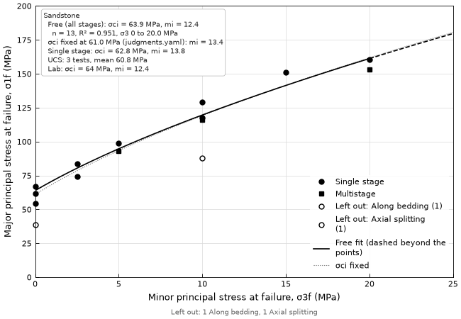
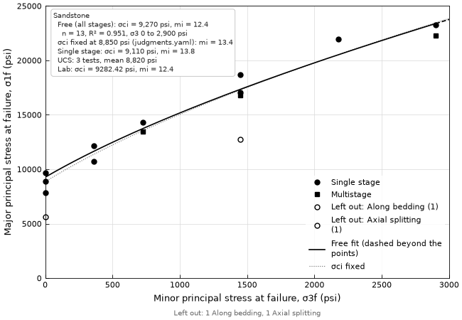

# P32 — Hoek–Brown envelope: σ1 against σ3 for intact rock

| | |
|---|---|
| **ID / function** | P32 · `ht.plot.hoek_brown_envelope()` (+ `ht.analysis.hoek_brown_fit()`) |
| **Status** | built |
| **Type** | plot + analysis |
| **Milestone** | M17 (c) (SPEC §12.4), [`docs/work/m17c-hoek-brown-fit.md`](../work/m17c-hoek-brown-fit.md) |
| **Depends on** | P00; `ht.analysis.triaxial_failure_stresses()` (M11 a); `hoek_brown_fit()` (M17 (c) Spec) |
| **Related** | P11 (the soil triaxial envelope, Mohr circles); P31 (the shear box envelope); sheet 15 |

---

## 1. Purpose
Draws a set of intact rock compression tests (UCS and triaxial, one lithology or one group) as points in σ1–σ3,
with the intact Hoek–Brown curves fitted free and with σci fixed, and states σci, mi, n and R² for each. Answers:
what σci and mi do these tests support, over what σ3, how well does one curve fit them, how far is the free σci
from the UCS tests, which specimens were left out and why, and how does the fit compare with the lab's. Used in lab
data reports and rock design calculation packages, before the rock mass chain (wave 4).

A figure of its own, not a space of P11 (M17 (c) intent, decision 8): P11 draws Mohr circles and takes a
`MohrCoulombFit`; here the curve lives in principal stress space and the result is a `HoekBrownFit`.

## 2. Reference figure
```
  σ1 (MPa)
  200 ┤ ┌──────────────────────────────────────┐
      │ │ Free: σci = 63.9 MPa, mi = 12.4      │              - - -
  150 ┤ │   n = 13, R² = 0.951, σ3 0–20 MPa    │     ●  ■ - -
      │ │ σci fixed at 61 MPa: mi = 13.4       │  ● ■ ·····
      │ │ Single stage: σci = 62.8, mi = 13.8  │ ●╱·
  100 ┤ │ UCS: 3 tests, mean 60.8 MPa          │╱■
      │ └──────────────────────────────────────┘
      │     ●╱ ●            × along bedding
   50 ┤ ●╱·
      │ ○ axial splitting
    0 ┼──────┴──────┴──────┴──────┴──────┴──────
      0      5     10     15     20     25   σ3 (MPa)
  ● single stage  ■ multistage  ○ × left out  ── free fit (dashed beyond the points)  ··· σci fixed
```
**A good version:** UCS points on the σ1 axis, where the eye checks them against the curve's intercept σci; the free
curve solid over the σ3 its points cover and dashed beyond, so σ1 past the last test reads as extrapolation; the
fixed curve lighter, so the two compare; points left out still drawn, open, with their reason, so nothing vanishes
from the figure; multistage stages told apart by their mark, so their bias (low σ1 at later stages) shows.

## 3. Input data
**Row grain:** one row per stage at failure, a UCS test being a row with a cell pressure of 0: a CSV in
`ht.template("triaxial")`'s shape through `ht.analysis.triaxial_failure_stresses()`, or `p.triaxial()`.

| Column | Description | Quantity kind | Req.? | Notes |
|---|---|---|---|---|
| `minor_principal_stress_at_failure`, `major_principal_stress_at_failure` | σ3, σ1 | stress | ✔ | written by `triaxial_failure_stresses()`; the `effective_` pair with `stress="effective"` |
| `failure_mode` | the lab's mode of failure, as written | text | – | with values, `failure_modes=` is required (the fit's decision 5) |
| `multistage_test` | the stage belongs to a multistage specimen | bool | – | its own mark; both fits in the box |
| `failure_criterion` | as written | text | – | not pooled unawares (the fit's decision 7) |
| `reported_intact_compressive_strength`, `reported_intact_hoek_brown_constant` | the lab's fit | stress, dimensionless | – | shown beside hangtu's |
| `specimen_id`, `test_stage` | names a point in messages | text | – | else the row's index |
| `geology_unit` | color, and a common `group_by=` | text | – | |

**Grouping columns used:** `group_by=` (one set of curves and one color per group); `color_by=` (points only,
without `group_by=`).

**Value flags handled:** none on the stresses. Rows the fit leaves out are drawn open and counted (§7, §8).

**Minimum data:** 1 row to draw; 2 points at different σ3 for the free curve, 1 point with σ3 > 0 for the fixed one.

## 4. Analysis / calculations
`ht.analysis.hoek_brown_fit()` (M17 (c) Spec, decisions 1–16; the derivation and golden values are there). The plot
calls it with the shared arguments and draws its result; it computes nothing of its own except the curve's points,
σ1 = σ3 + σci (mi σ3/σci + 1)^0.5 (Hoek 2007, ch. 11, eq. 5), from the fit's σci and mi.

**Fitted range.** The free curve of the main fit is solid from `lowest_minor_principal_stress` to
`highest_minor_principal_stress` and dashed from there to the right edge (and back to σ3 = 0 when the group has no
UCS point). The fixed curve is drawn from 0 to the right edge, thin and lighter (no solid part: σci is a constraint,
not a range). The other stage set's curves (single stage, or all) are not drawn; the box gives their values.

## 5. Figure layout
- **Panels:** one.
- **Default size:** the `default` kind (6.5 × 4.5 in).
- **Legend:** README's rule; marks (single stage, multistage, left out by reason) and line kinds (free, fixed) once
  each, colors per group. The result box takes the upper-left corner (the curves climb to the right), the legend the
  first clear one of the rest.

## 6. Axes
| X axis | Y axis |
|---|---|
| `Minor principal stress at failure, σ3f (MPa)` | `Major principal stress at failure, σ1f (MPa)` |

- The registry labels of the columns read; with `stress="effective"`, the `effective_` labels.
- **Limits:** x from 0 to a nice number above the largest σ3; y from 0 to a nice number above the largest σ1 or the
  free curve at the right edge. Not equal aspect: no slope is read as an angle here, and σ1 spans several times σ3.
- US labels use psf with `display_units="US"`, or psi with `ht.settings.display_overrides = {"stress": "psi"}`;
  SI uses kPa, or MPa with the override. `display_units=None` keeps the frame's unit (MPa for the example).

**Range constraints:** none beyond §6's limits.

## 7. Data marks
| Series | Mark | Color | Legend |
|---|---|---|---|
| Fitted single-stage points (UCS included) | filled circle | by group, else `color_by` | "Single stage" (black when there are colors) |
| Fitted multistage stages | filled square, same size | as above | "Multistage" |
| Left out by failure mode | open circle (open square for a multistage stage) | as above | "Left out: <mode> (n)", one entry per mode |
| Multistage stages left out (`multistage=False`) | open square | as above | "Left out: multistage (n)" |
| Free curve | solid over the fitted range, dashed beyond | black with one group; the group's color with several | "Free fit" |
| Fixed curve | thin dotted, 60 % opacity | as the free curve | "σci fixed" |
| User envelopes | gray line | — | the label given |

Rows without principal stresses (the fit's `count_no_principal_stresses`) can't be drawn and are counted in the
footnote.

## 8. Overlays and annotations
| Overlay | Argument | Default | Source of definition | Style | Notes |
|---|---|---|---|---|---|
| Fit curves | `fit=` | `True` | `hoek_brown_fit()` | §7 | `False` draws points only, and the result is None |
| Result box | `result_box=` | on with the fit | the fit | text box, upper left | per group: the main free fit's σci, mi, n, R², σ3 range; the fixed fit's σci (and where it came from) and mi; the other stage set's σci and mi when the group has multistage stages; the UCS count and mean; "Lab: σci = 64 MPa, mi = 12.4" where the rows have it; a fit with no result says why |
| User envelopes | `envelopes=` list of `(intact_compressive_strength, intact_hoek_brown_constant, label)` | off | user | gray | σci in the display units |
| Footnote | — | when anything is left out or out of range | the fit's counts and notes | README | "Left out: 1 axial splitting, 1 along bedding"; "1 point at σ3 ≥ 0.5 σci"; "R² below 0.9"; "fewer than 5 points" |
| `note` | as README | off | | | |

## 9. Units behavior
Stresses convert (MPa, kPa ↔ psi, psf); mi is the same in every unit (the fit converts σ1, σ3 and σci to one unit
first). The fit is made in the display units (`hoek_brown_fit(display_units=...)`), so the box, the axes and the
result agree. Rock reads best in MPa or psi: `display_units=None` keeps a CSV's MPa, and the settings override gives
MPa or psi for `"SI"` or `"US"`.

## 10. API
```python
def hoek_brown_envelope(
    df: pd.DataFrame,
    *,
    group_by: str | list[str] | None = None,
    color_by: str | None = None,
    failure_modes: Sequence[str | None] | None = None,
    fixed_intact_compressive_strength: str | Mapping[Any, str] | None = None,
    judgments: Any = None,
    multistage: bool = True,
    stress: Literal["total", "effective"] = "total",
    pool: str | list[str] | None = None,
    fit: bool = True,
    result_box: bool = True,
    envelopes: list[tuple[float, float, str]] | None = None,
    note: str | None = None,
    units: dict[str, str] | None = None,
    display_units: Literal["US", "SI"] | None = None,
    figsize: tuple[float, float] | None = None,
    ax: Axes | None = None,
    **style_overrides,
) -> tuple[Figure, Axes, HoekBrownFit | None]:
```
- `group_by=`, `failure_modes=`, `fixed_intact_compressive_strength=`, `judgments=`, `multistage=`, `stress=`,
  `pool=`, `units=` and `display_units=` go to `hoek_brown_fit()` as they are.
- `color_by=` colors points when there's no `group_by=`; its default is `geology_unit` when the rows have it, else
  one color. With `group_by=`, color is by group and `color_by=` is an error (one color per set of curves), as P11
  and P31.

**Examples:**
```python
rock = ht.analysis.triaxial_failure_stresses(
    ht.read_csv(ht.examples.path("rock_triaxial.csv"), units={...})
)
fig, ax, fit = ht.plot.hoek_brown_envelope(
    rock, group_by="geology_unit", failure_modes=["Shear"],
    judgments=ht.examples.path("judgments.yaml"),
)
```

## 11. Edge cases and data quality
| Situation | Behavior |
|---|---|
| No principal stress columns | The fit's error, pointing to `triaxial_failure_stresses()` and `ht.template("triaxial")` |
| `failure_mode` has values and `failure_modes=` isn't given | The fit's error listing each mode and its count |
| UCS rows only (every σ3 = 0) | Points on the σ1 axis; no curve; the box gives each fit's reason and the UCS mean |
| One σ3 above 0 besides UCS | Drawn; free curve; the footnote's "fewer than 5 points" |
| A fit with no result (intercept ≤ 0, slope ≤ 0, one σ3) | Its points drawn, no curve, its reason in the box; the other fit drawn |
| No fixed σci given | The free curve only; the box says the fixed fit needs `fixed_intact_compressive_strength=` or the judgments file |
| Points at σ3 ≥ 0.5 σci | Drawn and fitted, with the fit's warning and the footnote count |
| Negative σ3, or σ1 < σ3 | The fit's error naming the rows |
| Mixed failure criteria | The fit's error naming each value and count; `pool=` draws them as one set |
| `color_by=` with `group_by=` | Error (§10) |
| Missing units | The fit's error naming the column |
| Optional columns missing (`failure_mode`, `multistage_test`, `failure_criterion`, `geology_unit`) | One hint listing them and what each adds |

## 12. Acceptance criteria and tests
Golden values are the M17 (c) Spec's (AC 1–10), hand-calculated there. Tolerance 1e-9 relative on drawn data unless
stated.
1. **Curves:** Hoek (2007) Table 1's five points draw the free curve through σ1 = σci = 37.3939088 at σ3 = 0 and
   through σ3 + (a + b σ3)^0.5 with a = 950847/680 and b = 197071/340 at σ3 = 10; solid from 0 to 20, dashed beyond.
   With `fixed_intact_compressive_strength="38.3 MPa"`, the fixed curve passes through σ1 = 38.3 at σ3 = 0 with
   mi = 15.0132572.
2. **Points:** the example sandstone draws 13 filled marks (10 circles, 3 squares) at their (σ3, σ1), the axial
   splitting UCS as an open circle at (0, 38.6) and the bedding failure as an open circle at (10, 88.0), each mode
   in the legend with its count.
3. **`multistage=False`** draws the 3 multistage stages as open squares, the single-stage curve (σci 62.7985047,
   mi 13.7700751) as the main one, and the box gives the all-stages fit second.
4. **Axes:** §6's labels and limits; not equal aspect.
5. **Groups:** two hand-built groups draw two sets of curves in two colors, and one box with both.
6. **Returns:** `(fig, ax, fit)` with `fit` equal to `hoek_brown_fit()` on the same rows and arguments;
   `fit=False` returns None and draws no curve; `ax=` draws into the given axes without a new figure.
7. **Units:** Table 1 in MPa and in psi (× 145.037738) gives the same mi in the box (1e-9 relative) and σci scaled;
   labels in MPa and psi with the override.
8. **Edge cases:** each row of §11 that raises raises, with its message naming what §11 says; each that draws,
   draws (a hand-built frame per case).
9. **Visual check:** `docs/plots/img/P32-si.png` (the example sandstone in MPa) and `P32-us.png` (the same in psi),
   at 100 dpi, looked at and committed in the close-out.





## 13. References
- Hoek, E. (2007). *Practical Rock Engineering*, ch. 11, eq. 5, p. 2: the intact Hoek–Brown criterion, and the σ3
  range 0 < σ3 < 0.5 σci with at least five well-spaced points; eqs. 6–9 and Table 1, pp. 4–5: the regression. [V]
- Hoek, E. (2023). *Practical Rock Engineering*, ch. 3, p. 6: remove tests with failure modes other than shear;
  3, preferably 5, triaxial tests besides the UCS tests. [V]
- The fit is least squares on Hoek's line, derived in the M17 (c) Spec. ASTM D7012-23 defines the tests.

## 14. Open questions
- None beyond the M17 (c) Spec's 🟡 items, for review with it.

**Pitfalls:**
- Drawing the free curve solid across the whole axis, which reads as if σ1 were measured past the last test.
- Dropping the points left out from the figure, so a reader can't see what the fit didn't use.
- Plotting UCS points from a separate dataset with a different σci than the one in the fit's box.
- Rounding σci and mi inside the analysis; round only for display.

## 15. Future enhancements
- `space="regression"`: (σ1 − σ3)² against σ3, where the fit is a straight line and an outlier stands out (the
  intent's open inset; deferred, the fit's decision 16).
- Tensile points (σ3 < 0) and the curve into tension (wave 4, Read 2015).
- The brittle–ductile line σ1 = 4.5 σ3 (Hoek 2023, ch. 3, Fig. 3) as an overlay.
- `HoekBrownFit.plot()` to draw a result without refitting.
